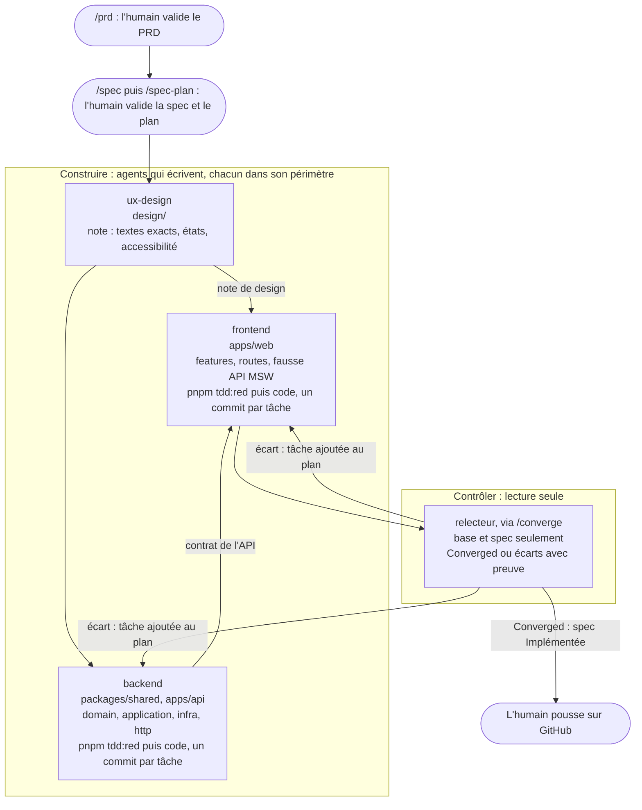

# L'équipe d'agents Claude Code

Pour construire une tranche du PRD, quatre agents se passent le travail. Chacun a un métier, un périmètre de fichiers qu'il est seul à modifier, et des garde-fous qui reprennent la méthode du dépôt (`specs/constitution.md`). Leurs définitions sont dans `.claude/agents/`.

## Pourquoi plusieurs agents

- **Un métier, un périmètre.** Le designer n'écrit pas de code, le backend ne touche pas aux écrans, le frontend ne touche pas à l'API. Un fichier modifié hors périmètre est un écart, facile à repérer.
- **Celui qui produit ne valide pas.** Le `relecteur` part d'un contexte vierge et juge le travail des trois autres (principe 6 de la constitution).
- **Un contrat entre eux.** Le designer fixe les textes et les états de l'écran ; le backend publie le contrat de l'API ; le frontend s'appuie sur les deux. Chaque passage de relais est un fichier relu, pas une conversation.

## Qui fait quoi

| Agent       | Métier                | Seul à modifier                 | Il lit                                                      | Il rend                                                                        |
| ----------- | --------------------- | ------------------------------- | ----------------------------------------------------------- | ------------------------------------------------------------------------------ |
| `ux-design` | Designer UX/UI        | `design/`                       | spec, plan, Podium Dakar, `design/systeme.md`               | `design/NNN-nom.md` : parcours, structure, textes exacts, états, accessibilité |
| `backend`   | Développeur API       | `packages/shared/`, `apps/api/` | spec, plan (tâches API), module `sport-events`              | les tâches API faites en TDD, un commit chacune, et le contrat de l'API        |
| `frontend`  | Développeur écrans    | `apps/web/`                     | spec, plan (tâches écran), note de design, contrat de l'API | les tâches écran faites en TDD, un commit chacune, avec l'audit axe            |
| `relecteur` | Relecteur indépendant | rien                            | la base git et le dossier de la spec, seulement             | le verdict `Converged`, ou les écarts bloquants avec preuve                    |

`devops` (intégration continue) et les skills (`/prd`, `/spec`, `/spec-plan`, `/tdd-task`, `/converge`) complètent l'équipe.

## Le déroulé d'une tranche



L'ordre compte : une API d'abord, un écran ensuite (« Une API d'abord » dans `task/ATELIER-C.md`), et pas d'écran sans sa note de design.

## Les lancer

Dans Claude Code, à la racine du dépôt, on demande l'agent par son nom avec la spec et les tâches :

```
Utilise l'agent ux-design pour specs/004-medailles.
Utilise l'agent backend pour specs/004-medailles, tâches T01 à T04.
Utilise l'agent frontend pour specs/004-medailles, tâches T05 et T06.
/converge specs/004-medailles
```

Chaque agent rend un rapport au même format : tâches faites avec leur commit, ce qui a été vérifié, ce qu'un humain doit décider. Il s'arrête après deux échecs sur la même tâche, au lieu d'insister.

## Les garde-fous communs

- Aucun agent ne modifie `spec.md` ni les tâches d'un plan validé : un besoin nouveau passe par `/prd`, puis `/spec`.
- Le backend et le frontend écrivent le test d'abord, prouvent qu'il échoue pour la bonne raison (`pnpm tdd:red`), puis écrivent le code minimal ; `pnpm verify` avant chaque commit, jamais `--no-verify`.
- Aucun agent ne pousse, et aucun ne valide son propre travail.
- Les tests n'appellent ni le réseau ni Claude : les sources externes et l'assistant IA sont derrière des ports, avec un faux dans les tests.
- La clé de l'API Claude reste dans `apps/api/.env`, jamais dans le code.

Ces garde-fous sont vérifiés par `pnpm test` : `.claude/hooks/agents.test.mts` échoue si un agent perd son périmètre, son test d'abord, son interdiction de `--no-verify` ou de pousser.

## Essai réel

L'équipe a été essayée sur une spec jetable (`999-essai-agents`, une règle du domaine et un format d'affichage), dans une copie du dépôt supprimée ensuite :

- `ux-design` a écrit le système de design (d'après Podium Dakar) et la note de l'écran de la spec 003, sans écrire ailleurs que dans `design/` ; il a mesuré un contraste insuffisant (vert sur sable, 4,4:1) et l'a écarté.
- `backend` a fait T01 test d'abord (`tdd:red` : « rouge pour la bonne raison »), un commit au bon format qui cite le scénario, et a **refusé** une demande glissée hors de son périmètre (changer un libellé dans `apps/web/`), en la renvoyant à l'agent `frontend`.
- `frontend` a fait T02 test d'abord (rouge pour une mauvaise raison d'abord, donc un squelette, puis rouge pour la bonne), un commit au bon format, sans toucher à `apps/api/`.
- Dans la copie, `pnpm check` est resté vert (166 tests) et `pnpm spec:check --trace` relie chaque scénario à son test.

## Le coût

Les agents tournent sur le compte avec lequel Claude Code est connecté. Avec une licence Claude Max, ils n'entament pas les crédits de l'API. Lancés avec une clé (`ANTHROPIC_API_KEY` dans le terminal), ils consomment ces crédits : une tranche complète (design, API, écran, relecture) représente beaucoup de lecture et d'écriture de code. Les crédits de l'API servent d'abord aux fonctions de l'application qui appellent Claude, comme le résumé du jour (TR8), qui ne coûte que quelques centimes par résumé.
